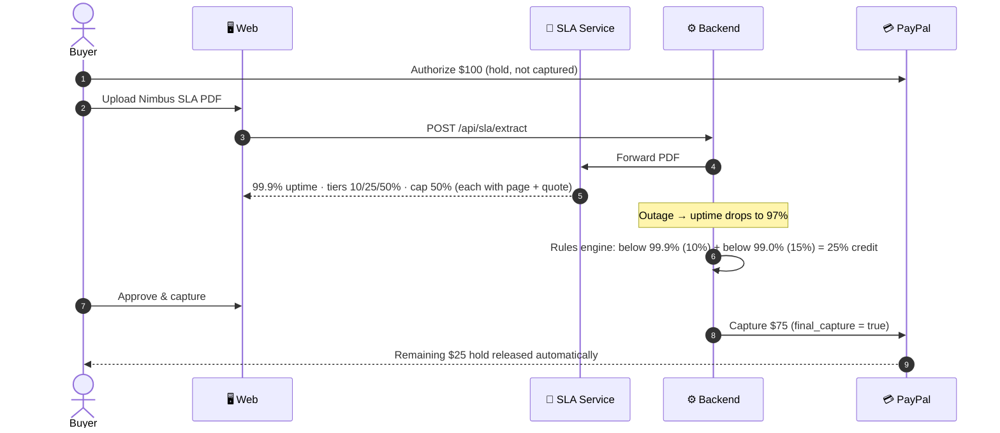
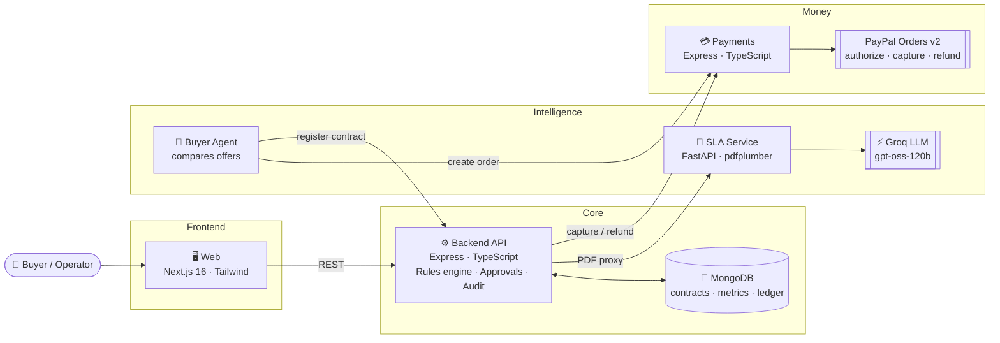

<div align="center">

# 💸 Pay-for-Performance

### Don't pay for promises. Pay for verified performance.

**AI reads the SLA. Code verifies it. A human approves. PayPal settles only what was earned.**

[](https://p4p-web.onrender.com)
[](https://developer.paypal.com/docs/api/orders/v2/)
[](https://groq.com)


</div>

---

## 🎯 The problem

Every API, cloud and hosting contract comes with an **SLA**: *"99.9% uptime, or you get up to 50% back."*

In practice, almost nobody collects:

- 📄 The promises are buried in long PDF contracts.
- 🔍 The buyer has to notice the outage, read the contract and work out the credit.
- 📨 Then they have to file a claim, and wait.

**Result:** providers get paid in full even when they break their promises.

## 💡 Our solution

We tie the **contract** to the **payment**, so the money is never fully sent until the service has earned it.

<table>
<tr>
<td align="center" width="16%">🔒<br/><b>Hold</b><br/><sub>PayPal authorizes $100, nothing captured yet</sub></td>
<td align="center" width="16%">🤖<br/><b>Read</b><br/><sub>AI extracts promises with page and quote</sub></td>
<td align="center" width="16%">✅<br/><b>Verify</b><br/><sub>Plain code checks every AI claim</sub></td>
<td align="center" width="16%">📉<br/><b>Monitor</b><br/><sub>Real uptime tracked against the SLA</sub></td>
<td align="center" width="16%">🧑‍⚖️<br/><b>Approve</b><br/><sub>A human signs off on the credit</sub></td>
<td align="center" width="16%">💰<br/><b>Settle</b><br/><sub>PayPal captures $75, releases $25</sub></td>
</tr>
</table>

> **The buyer never chases a refund, because the money was never fully sent.**

---

## 🎬 The demo in 60 seconds



| Step | What happens | Money |
|:---:|---|---:|
| 1 | Buyer authorizes the order on PayPal Sandbox | **$100 held** |
| 2 | AI reads the SLA: 99.9% uptime, tiered credits, 50% cap | — |
| 3 | Outage simulated: uptime falls to **97%** | — |
| 4 | Deterministic engine calculates a **25% credit** | −$25 |
| 5 | Human approves → PayPal captures with `final_capture` | **$75 paid** |
| 6 | PayPal releases the rest of the hold to the buyer | **$25 back** |

---

## 🛡️ Why you can trust AI near money

AI is great at reading messy contracts. It is **not** allowed to decide money.

| Layer | Who does it | Can it be wrong? |
|---|---|---|
| Read the PDF and extract terms | 🤖 Groq LLM (strict JSON schema) | Yes, so it's checked ⬇️ |
| Prove every value is really in the contract | ✅ Plain Python code | No: exact quote and number match |
| Calculate the credit | ⚙️ Deterministic rules engine | No: same input, same output |
| Approve the settlement | 🧑‍⚖️ A human | Final say |
| Move the money | 💳 PayPal | Idempotent, captured once |

**What the validation layer catches** before any money moves:

- ❌ A quote that isn't in the PDF, or a number that isn't in its quote (hallucination)
- 📍 A quote cited on the wrong page (auto-corrected when it's unambiguous)
- 🌫️ Vague wording: *"up to"*, *"may"*, *"at our discretion"*, *"target"*, *"typically"*
- 🔀 Contradictions and credit tiers that don't increase with worse uptime
- 🚫 A missing credit cap, or exclusions with no hour limit
- 📉 AI confidence below 0.8

Anything suspicious is marked **"Needs human review"**, and the contract can't settle automatically.

<details>
<summary><b>📸 See it on the live Upload page</b></summary>

<br/>

| Clean contract (Nimbus) | Vague contract (Cirrus) |
|---|---|
| ✅ **AI Extracted · all checks passed** | ⚠️ **Needs human review**: 9 issues |
| Uptime ≥ 99.9%: *p.1 "Nimbus API Cloud guarantees … at least 99.9%."* | *"a credit of **up to** 15% **may** apply"* |
| Credit below 99.9% → 10%: *p.2* | No credit cap found |
| Credit below 99.0% → 25%: *p.2* | Force majeure excluded with **no hour limit** |
| Cap 50%: *p.3 "… will not exceed 50% of the monthly fee."* | Credit *"at Provider's sole discretion"* |

Try both buttons at **[p4p-web.onrender.com/upload](https://p4p-web.onrender.com/upload/)**.

</details>

---

## 🏗️ Architecture



### Live services

| Service | URL | Stack |
|---|---|---|
| 🖥️ Web | [p4p-web.onrender.com](https://p4p-web.onrender.com) | Next.js 16, React 19, Tailwind v4, Motion, AG-Grid |
| ⚙️ Backend API | [p4p-api.onrender.com/api/health](https://p4p-api.onrender.com/api/health) | Express, TypeScript, Mongoose 8 |
| 💳 Payments | [p4p-payments.onrender.com](https://p4p-payments.onrender.com) | Express, TypeScript, PayPal REST v2 |
| 🤖 SLA Service | [p4p-sla-service.onrender.com/health](https://p4p-sla-service.onrender.com/health) | FastAPI, pdfplumber, Groq, Pydantic |

> ⏳ Free-tier services sleep when idle. The first request may take ~30–40 seconds.

---

## ✨ Features

<table>
<tr>
<td width="50%" valign="top">

### 🤖 AI contract intelligence
- PDF → structured SLA terms in seconds
- Every value cites its **page and exact quote**
- Strict JSON schema output, no free-form guessing
- Prompt treats the contract as untrusted input
- Buyer agent rejects vague and over-budget offers

</td>
<td width="50%" valign="top">

### 💳 PayPal settlement
- **Authorize → Capture → Release** with Orders v2
- Partial capture with `final_capture: true`
- Refunds for credits found after capture
- Idempotency keys, so money never moves twice
- Sandbox-ready end to end

</td>
</tr>
<tr>
<td width="50%" valign="top">

### ⚙️ Deterministic policy engine
- Tiered credit rules evaluated in code
- Credit caps and exclusion windows enforced
- Synthetic monitoring and breach detection
- Human approval gate before every capture

</td>
<td width="50%" valign="top">

### 🖥️ Control center
- Drag-and-drop SLA upload with live AI results
- Outage simulator on the dashboard
- One-click approve and capture
- Transaction ledger and tamper-evident audit log

</td>
</tr>
</table>

---

## 👥 The team

| | Member | Role | Owns |
|:---:|---|---|---|
| 💳 | **[Paras Chavan](https://github.com/ParasChavan02)** | Payment Systems Engineer | `apps/payments`: PayPal authorize, capture, refund and idempotency |
| 🤖 | **[Tanmay Shinde](https://github.com/Tanny28)** | AI & SLA Intelligence Engineer | `apps/sla-service`: PDF extraction, Groq LLM, validation layer, buyer agent |
| ⚙️ | **[Manas Pandya](https://github.com/hindmanas)** | Backend Architect & Database Lead | `apps/api`: MongoDB, monitoring, breach engine, policy evaluator, audit |
| 🖥️ | **[Harshika Bodekar](https://github.com/harshikabodekar)** | Frontend Lead & UX Architect | `apps/web`: Control Center, outage simulator, approval flow, ledger UI |

---

## ⚡ Run it locally

<details>
<summary><b>1. Prerequisites</b></summary>

- Node.js 20+ and npm
- Python 3.10+
- MongoDB (Docker or Atlas)
- PayPal Sandbox app credentials and a free Groq API key

</details>

<details>
<summary><b>2. Environment files</b></summary>

| File | Keys |
|---|---|
| `apps/payments/.env` | `PAYPAL_CLIENT_ID`, `PAYPAL_CLIENT_SECRET` |
| `apps/api/.env` | `MONGODB_URI`, `PAYMENT_SERVICE_URL=http://localhost:4000/api`, `SLA_SERVICE_URL=http://localhost:8000` |
| `apps/sla-service/.env` | `GROQ_API_KEY` |
| `apps/web/.env.local` | `NEXT_PUBLIC_API_URL=http://localhost:5000` |

Each app has a `.env.example`. Real keys never go in the repo.

</details>

<details open>
<summary><b>3. Start everything</b></summary>

```bash
npm install
docker compose -f infra/mongodb/docker-compose.yml up -d   # or use MongoDB Atlas
npm run seed                                               # demo services, contracts, breaches
npm run dev                                                # all 4 services at once
```

| App | Local URL | Run alone |
|---|---|---|
| Web | http://localhost:3000 | `npm run dev:web` |
| Payments | http://localhost:4000 | `npm run dev:payments` |
| Backend API | http://localhost:5000 | `npm run dev:api` |
| SLA Service | http://localhost:8000 | `npm run dev:sla` |

</details>

<details>
<summary><b>4. Tests</b></summary>

```bash
npm run test:all     # payments + backend + SLA service
npm run test:sla     # SLA service only (pdf extraction, validation, API, buyer agent)
npm run build        # production builds of payments, api and web
```

</details>

---

## 📁 Repository layout

```
pay-for-performance/
├── apps/
│   ├── web/           🖥️  Next.js control center
│   ├── api/           ⚙️  Express backend, rules engine, MongoDB
│   ├── payments/      💳  PayPal Orders v2 integration
│   └── sla-service/   🤖  FastAPI + Groq SLA extraction and buyer agent
├── packages/          📦  Shared contracts and config
├── infra/             🐳  MongoDB compose and deployment guides
├── docs/              📚  Architecture, API endpoints, setup
├── scripts/           🛠️  Dev runner and sample generators
└── render.yaml        🚀  One-click deploy of all 4 services
```

📚 More detail: [Architecture](docs/architecture/overview.md) · [API endpoints](docs/api/endpoints.md) · [MongoDB setup](docs/setup/mongodb.md)

---

## 🔮 What's next

- 📡 Real monitoring integrations (Datadog, Grafana, Pingdom) in place of synthetic checks
- 📑 More SLA metrics: latency, error rate and support response time credits
- 🔁 Recurring billing with per-period automatic settlement
- 🧾 Signed, exportable audit reports for finance teams

---

<div align="center">

**Built for the PayPal AI Hackathon** · MIT License

*If the service didn't perform, you shouldn't pay as if it did.*

</div>
