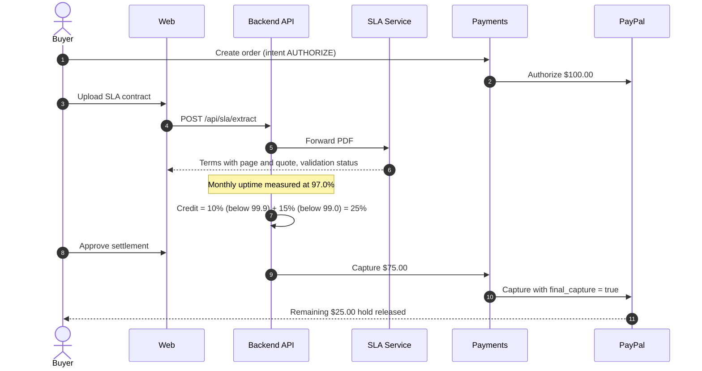
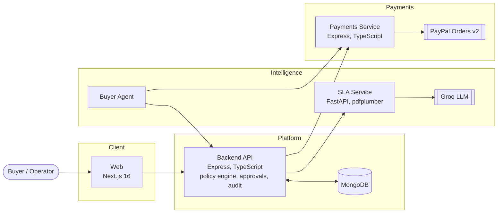

<div align="center">

# Pay-for-Performance

**SLA-aware payment settlement on PayPal.**
AI reads the contract, deterministic code verifies it, a human approves, and PayPal captures only what the service earned.

[Live demo](https://p4p-web.onrender.com) · [Architecture](docs/architecture/overview.md) · [API reference](docs/api/endpoints.md)


</div>

---

## Overview

Service-level agreements promise compensation when a provider misses its targets: *"99.9% monthly uptime, or a 10–50% service credit."* In practice those credits are rarely collected. The terms sit in long PDF contracts, and the buyer has to detect the breach, interpret the contract, calculate the credit and file a claim.

Pay-for-Performance links the contract to the payment itself. Funds are **authorized** on PayPal at purchase but not captured. Once the measurement period closes, the platform compares real performance against the extracted SLA, calculates the credit, and, after human approval, **captures only the earned amount**. PayPal releases the remainder of the hold to the buyer automatically.

## How it works

| Stage | Component | Responsibility |
|---|---|---|
| 1. Authorize | Payments service | Create a PayPal order with `intent: AUTHORIZE` and place a hold on the full amount |
| 2. Extract | SLA service | Parse the contract PDF and extract commitments, credit tiers, caps and exclusions, each with a page number and verbatim quote |
| 3. Validate | SLA service | Verify every extracted value against the source text in deterministic code; flag anything ambiguous for review |
| 4. Monitor | Backend API | Record service metrics and detect SLA breaches for the measurement window |
| 5. Calculate | Backend API | Evaluate credit rules, caps and exclusions in a deterministic policy engine |
| 6. Approve | Web | An operator reviews the evidence and approves the settlement |
| 7. Settle | Payments service | Capture the earned amount with `final_capture: true`; PayPal releases the rest |

### Reference scenario



| | Event | Amount |
|---|---|---:|
| 1 | Order authorized on PayPal | $100.00 held |
| 2 | SLA extracted: 99.9% uptime, tiered credits of 10 / 25 / 50%, 50% cap | – |
| 3 | Measured uptime falls to 97.0% | – |
| 4 | Policy engine applies a 25% service credit | −$25.00 |
| 5 | Operator approves; PayPal captures the earned amount | $75.00 captured |
| 6 | PayPal releases the uncaptured balance | $25.00 returned |

## Design principle: AI reads, code decides

Language models are well suited to reading unstructured contracts and poorly suited to deciding financial outcomes. The system separates the two.

| Concern | Handled by | Guarantee |
|---|---|---|
| Reading the contract | LLM (Groq, `openai/gpt-oss-120b`) with a strict JSON schema | Structured output only; the document is treated as untrusted input |
| Verifying the extraction | Deterministic validation layer | Every value must appear in a verbatim quote on the cited page |
| Calculating the credit | Policy engine | Same inputs always produce the same result |
| Authorizing the payout | Human operator | No capture without explicit approval |
| Moving funds | PayPal Orders v2 | Idempotent requests; each capture executes once |

The validation layer rejects or escalates an extraction when:

- a quote does not appear in the document, or an extracted number does not appear in its quote;
- a quote is attributed to the wrong page (corrected automatically when the location is unambiguous);
- the clause uses non-binding language such as *up to*, *may*, *target*, *typically* or *at our discretion*;
- thresholds contradict each other, or credit tiers do not increase with the severity of the breach;
- no credit cap is stated, or an exclusion has no upper bound on hours;
- model confidence is below 0.8.

Any finding sets the contract to **Needs review**, and it cannot settle automatically. A buyer agent applies the same checks before purchase: it compares provider offers, rejects contracts that need review or exceed the budget, and selects the offer with the strongest credit protection.

## Architecture



| Service | Path | Stack | Deployment |
|---|---|---|---|
| Web | `apps/web` | Next.js 16, React 19, Tailwind CSS v4, AG Grid | [p4p-web.onrender.com](https://p4p-web.onrender.com) |
| Backend API | `apps/api` | Express, TypeScript, Mongoose 8 | [p4p-api.onrender.com](https://p4p-api.onrender.com/api/health) |
| Payments | `apps/payments` | Express, TypeScript, PayPal REST v2 | [p4p-payments.onrender.com](https://p4p-payments.onrender.com) |
| SLA Service | `apps/sla-service` | Python, FastAPI, pdfplumber, Pydantic, Groq | [p4p-sla-service.onrender.com](https://p4p-sla-service.onrender.com/health) |

> The demo runs on Render's free tier. Services sleep when idle, so the first request can take 30–40 seconds.

## Capabilities

**Contract intelligence**
- PDF to structured SLA terms, with page-level citations for every value
- Schema-constrained model output and prompt-injection-aware instructions
- Deterministic validation with human escalation for ambiguous terms

**Settlement**
- Authorize, partial capture and release through PayPal Orders v2
- Refunds for credits identified after capture
- Idempotency keys on every money-moving request

**Policy and monitoring**
- Tiered credit rules, credit caps and exclusion windows
- Synthetic monitoring and breach detection
- Approval gate before every capture

**Operations console**
- Contract upload with extracted terms and review findings
- Outage simulation, settlement approval and transaction ledger
- Tamper-evident audit log

## Getting started

### Prerequisites

- Node.js 20+ and npm
- Python 3.10+
- MongoDB (local via Docker, or Atlas)
- PayPal Sandbox REST credentials and a Groq API key

### Configuration

Copy each `.env.example` to `.env` and fill in the values. Credentials are never committed.

| File | Variables |
|---|---|
| `apps/payments/.env` | `PAYPAL_CLIENT_ID`, `PAYPAL_CLIENT_SECRET` |
| `apps/api/.env` | `MONGODB_URI`, `PAYMENT_SERVICE_URL=http://localhost:4000/api`, `SLA_SERVICE_URL=http://localhost:8000` |
| `apps/sla-service/.env` | `GROQ_API_KEY` |
| `apps/web/.env.local` | `NEXT_PUBLIC_API_URL=http://localhost:5000` |

### Run

```bash
npm install
docker compose -f infra/mongodb/docker-compose.yml up -d
npm run seed
npm run dev
```

| Service | URL | Command |
|---|---|---|
| Web | http://localhost:3000 | `npm run dev:web` |
| Payments | http://localhost:4000 | `npm run dev:payments` |
| Backend API | http://localhost:5000 | `npm run dev:api` |
| SLA Service | http://localhost:8000 | `npm run dev:sla` |

### Test

```bash
npm run test:all   # payments, backend API and SLA service
npm run test:sla   # SLA service: extraction, validation, API and buyer agent
npm run build      # production builds
```

## Repository structure

```
apps/
  web/            Next.js operations console
  api/            Backend API, policy engine, monitoring, audit
  payments/       PayPal Orders v2 integration
  sla-service/    SLA extraction, validation and buyer agent
packages/         Shared contracts and configuration
infra/            MongoDB compose file and deployment guides
docs/             Architecture, API reference and setup guides
scripts/          Development runner and sample generators
render.yaml       Render blueprint for all four services
```

## Roadmap

- Integrations with production monitoring providers in place of synthetic checks
- Additional SLA metrics: latency, error rate and support response time
- Recurring billing with automatic settlement per measurement period
- Signed, exportable audit reports for finance teams

## Team

| Name | Role | Area |
|---|---|---|
| [Paras Chavan](https://github.com/ParasChavan02) | Payment Systems Engineer | `apps/payments`: PayPal authorization, capture, refunds and idempotency |
| [Tanmay Shinde](https://github.com/Tanny28) | AI & SLA Intelligence Engineer | `apps/sla-service`: contract extraction, validation layer and buyer agent |
| [Manas Pandya](https://github.com/hindmanas) | Backend Architect & Database Lead | `apps/api`: persistence, monitoring, breach detection and policy engine |
| [Harshika Bodekar](https://github.com/harshikabodekar) | Frontend Lead & UX Architect | `apps/web`: operations console, outage simulation and approval flow |

## License

Released under the [MIT License](LICENSE). Built for the PayPal AI Hackathon.
